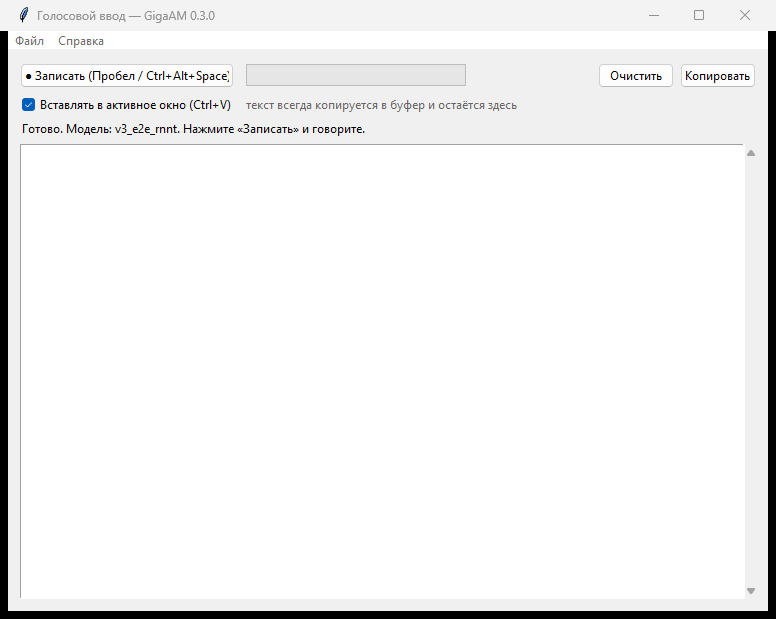

# Голосовой ввод на GigaAM

Офлайн-диктовка на русском: держите **Ctrl+Alt+Space**, говорите, отпустили — текст
появился в том окне, где стоял курсор. Работает без интернета, модель GigaAM-v3
(Сбер, MIT) крутится на CPU.



## Возможности

- **Режим рации**: запись идёт, пока зажаты клавиши, паузы внутри фразы не режут её.
- **Вставка в любое окно**: текст уходит по Ctrl+V туда, где был фокус (1С, Word, браузер).
- **Длинные фразы**: запись режется по паузам на куски до 20 с и склеивается, лимит — 120 с.
- **Словарь замен**: «как слышится = Как надо» для имён, артикулов, названий.
- **Пунктуация и регистр** — из модели `v3_e2e_*`.
- **Индикатор внизу экрана**: «Запись…», «Распознаю…», «Вставлено», не забирает фокус.
- **Настройки** в окне: модель, микрофон, хоткеи, пауза, лимит записи, автовставка.
- Один экземпляр, логи в `.cache/`, диагностика в меню «Справка».

## Установка из исходников

Требуется Windows 10/11, Python 3.12, [uv](https://docs.astral.sh/uv/), `ffmpeg` в PATH.

```cmd
install.cmd
run.cmd
```

`install.cmd` создаёт `.venv`, ставит CPU-сборку torch, зависимости и добирает
`gigaam` с GitHub (в PyPI лежит версия без моделей v3). Первый запуск скачает
чекпойнт 428 МБ; если канал медленный:

```cmd
.venv\Scripts\python.exe tools\fetch_model.py --workers 8
```

## Сборка exe

```cmd
build.cmd          :: сборка + подпись
build.cmd trust    :: то же + сертификат в доверенные (SmartScreen молчит на этой машине)
```

Обе команды собирают и сразу подписывают exe самоподписанным сертификатом
(он создаётся один раз и переиспользуется). `trust` дополнительно импортирует
сертификат в «Доверенные корневые центры» — Windows покажет один запрос.

Результат — `dist\Voice2Text\Voice2Text.exe` (папку целиком, ~2.5 ГБ из-за torch).
Модель сборка кладёт в `dist\models` — она переживает пересборку и не качается заново;
приложение ищет её там, в `%LOCALAPPDATA%\voice2text`, в `%TEMP%` и в каталоге
`VOICE2TEXT_MODEL_DIR`. Недокачанные куски запоминаются и докачиваются при следующем
запуске, а не с нуля.
Настройки и модель в сборке лежат в `%LOCALAPPDATA%\voice2text`.

Для установщика можно взять [Inno Setup](https://jrsoftware.org/isinfo.php) и
упаковать папку `dist\Voice2Text` — скрипт `installer\voice2text.iss` прилагается.

## Использование


- **Ctrl+Shift+Space** — диктовка. В режиме «переключатель» первое нажатие начинает запись,
  второе останавливает; в режиме «удерживать» пишет, пока клавиши зажаты (если отпускание
  не поймалось — повторное нажатие, кнопка «Стоп» или пункт трея останавливают).
  **Ctrl+Shift+W** — показать окно.
- Кнопка «Записать» и пробел (когда окно в фокусе) — то же самое.
- Автостоп по паузе включается в настройках; без него запись идёт до «Стоп» или лимита.
- Крестик сворачивает окно на панель задач; иконка в трее создаётся дополнительно
  (Windows 11 прячет новые значки в «^» — включите в «Другие значки»).
- Настройки — в правой панели главного окна (модель, микрофон, хоткеи, пауза, лимит, замены),
  применяются сразу после изменения. Хоткей задаётся кнопкой «Записать»: нужна комбинация
  «Ctrl/Shift/Alt + клавиша»; Win и одиночные клавиши не поддерживаются.
## Как устроено

```
микрофон (sounddevice) → VAD по энергии → int16 16 кГц → нарезка по паузам
        → GigaAM v3 e2e RNNT → замены/чистка → буфер + Ctrl+V в активное окно
```

- `recorder.py` — поток 30 мс, шумовая полка, предролл, push-to-talk по отпусканию.
- `asr_engine.py` — ленивая загрузка модели, кэш в `.cache/gigaam`, нарезка длинных
  записей, обход ограничения sentencepiece на кириллические пути (загрузка из байтов).
- `app.py` — окно, трей, глобальные хоткеи, индикатор, вставка, логи.
- `config.py`, `settings_ui.py` — настройки и диалог.
- `postprocess.py` — словарь замен и чистка пробелов.
- `model_fetch.py` — проверка и параллельная докачка чекпойнта.
- `tools/` — установка gigaam/antlr4 и параллельная загрузка модели.

Замеры на CPU: загрузка модели 3 с, распознавание 9-секундной фразы ~1 с.

## Подпись и предупреждения Windows

SmartScreen показывает «Windows защитила ваш компьютер» для любого неподписанного
exe, а UAC-запрос появляется, если ярлык настроен на «Запуск от имени администратора»
(обычному режиму права админа не нужны). Варианты:

- **Настоящий сертификат подписи кода** (OV/EV у любого УЦ) — единственный способ
  убрать предупреждение на чужих машинах. Подпись: `signtool sign /f cert.pfx /p ... exe`.
- **Самоподписанный сертификат** — убирает предупреждение только на этой машине:
  ```powershell
  powershell -ExecutionPolicy Bypass -File tools\sign.ps1 -Trust
  ```
  Сертификат создаётся в хранилище пользователя и добавляется в «Доверенные корневые
  центры» и «Доверенные издатели» (это хранилище сертификатов, а не правка реестра
  вручную; для добавления нужны права администратора один раз).
- **Запуск из исходников** (`run.cmd`) — предупреждений нет, но нужен Python.

Важно: подпись не отменяет UAC. Если ярлык или exe запускаются с повышением прав,
запрос останется; приложению администратор не требуется.

## Ограничения

- Не потоковый ASR: текст появляется после отпускания клавиш, а не по словам.
- Один кусок распознавания — до 25 с (ограничение `transcribe`), длинное режется по паузам.
- Только русский, без диаризации (кто говорил).
- Если целевое окно запущено от администратора, а приложение нет — Windows (UIPI)
  не даст ни вставить текст, ни увидеть отпускание клавиш: запускайте приложение
  тоже от администратора (пока запись не остановлена — хоткей работает как «стоп»).

## Если что-то не работает

- **Не видно иконки в трее** — Windows 11 прячет новые значки: стрелка `^` у часов,
  затем перетащите иконку на панель. Окно всегда открывается по Ctrl+Alt+W.
- **Текст без запятых** — загрузилась модель-фолбэк `v3_rnnt`; в `.cache/app.log`
  будет строка `не удалось`. Пунктуацию дают только `v3_e2e_*`.
- **Текст в буфере, но не вставился** — в логе `SendInput: … ошибка 5` значит UIPI:
  запустите приложение от администратора.
- **Хоткей не срабатывает, ошибка 1409** — комбинацию держит другой экземпляр.
- **«Не удалось открыть микрофон»** — Параметры → Конфиденциальность → Микрофон;
  проверьте `cli.py --devices`.
- **Модель не загрузилась** — удалите `.cache/gigaam/*.ckpt` и повторите `fetch_model.py`.
