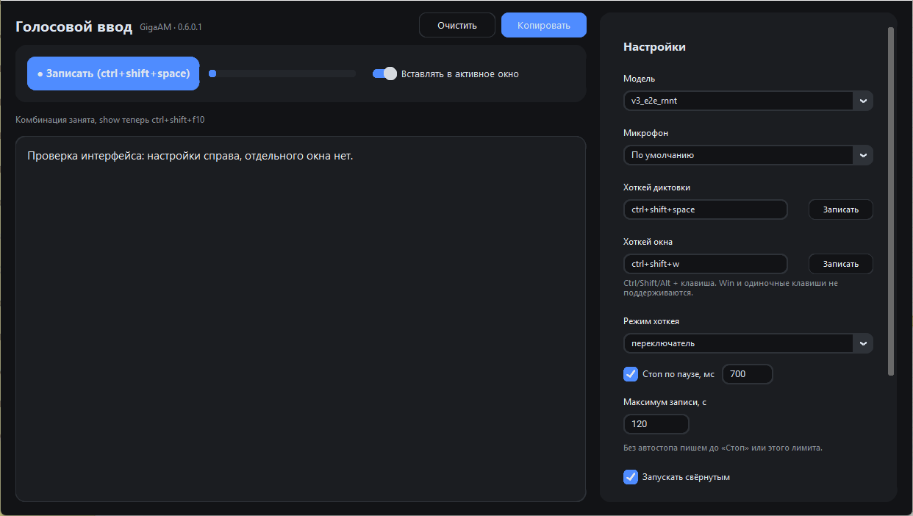

# Voice2Text — офлайн-диктовка на GigaAM

[](https://github.com/USER/voice2text/actions/workflows/check.yml)
[](LICENSE)

Локальное распознавание русской речи с микрофона и вставка текста в любое окно Windows.
Без облака, без подписки, без отправки звука наружу: модель GigaAM-v3 (Сбер) работает на CPU
прямо на вашем компьютере.



- **Push-to-talk и переключатель** — `Ctrl+Shift+Space` начинает/останавливает запись,
  режим «удерживать» пишет, пока клавиши зажаты.
- **Вставка в активное окно** — распознанный текст кладётся в буфер и вставляется `Ctrl+V`
  туда, где был курсор: Блокнот, браузер, мессенджер, 1С.
- **Пунктуация и регистр** — модель `v3_e2e_rnnt` отдаёт готовый текст, без ручной правки.
- **Автостоп по паузе** — настраивается или отключается совсем (тогда до кнопки «Стоп»).
- **Словарь замен** — «как слышится = Как надо» для имён, терминов, аббревиатур.
- **Трей, горячие клавиши, тёмная тема** — приложение живёт в фоне и не мешает.

## Требования

- Windows 10/11 x64.
- Микрофон.
- ~1,1 ГБ на диске: 605 МБ программа + 430 МБ модель.
- Интернет нужен только один раз — скачать модель при первом запуске.

## Установка

### Готовый установщик

Установщик лежит **не в файлах репозитория**, а в разделе
[**Releases**](../../releases/latest) — он справа на странице репозитория, под описанием
(прямая ссылка: `https://github.com/<логин>/voice2text/releases`). Архив весит ~250 МБ,
поэтому в git его не кладут.

1. Открыть Releases → последний релиз → в блоке **Assets** скачать
   `Voice2Text-<версия>-installer.zip`, распаковать.
2. Запустить `setup.exe`. Права администратора не нужны: программа ставится в
   `%LOCALAPPDATA%\Programs\Voice2Text`, создаются ярлыки и запись в «Установка и удаление
   программ».
3. Первый запуск скачивает модель (~430 МБ), прогресс виден в строке состояния.

Если в Releases пусто — релиз ещё не опубликован, тогда установщик можно собрать самому
(см. «Сборка exe и установщика») или работать из исходников.
Windows покажет SmartScreen (сборка подписана самоподписанным сертификатом):
«Подробнее» → «Выполнить в любом случае».

### Из исходников

Нужны Python 3.12, [uv](https://docs.astral.sh/uv/) и `ffmpeg` в `PATH`.

```bat
install.cmd   :: создаёт .venv и ставит зависимости
run.cmd       :: запускает приложение из исходников
```

### Сборка exe и установщика

```bat
build.cmd          :: PyInstaller + подпись -> dist\Voice2Text
build.cmd trust    :: то же + сертификат в доверенные (SmartScreen молчит на этой машине)
.venv\Scripts\python.exe installer\build_installer.py
                   :: -> dist-installer\Voice2Text-<версия>-installer.zip
```

Установщик не требует Inno Setup: `setup.exe` — обычное приложение на Python, а приложение
лежит рядом в `payload.zip`.

## Использование

| Действие | Как |
|---|---|
| Диктовка | `Ctrl+Shift+Space` (или кнопка «Записать», или пробел в окне приложения) |
| Показать окно | `Ctrl+Shift+W` |
| Остановить запись | повторное нажатие хоткея, кнопка «Стоп», пункт трея |
| Настройки | правая панель главного окна, применяются сразу |
| Свернуть в трей | крестик окна или меню «Файл → Свернуть» |

Хоткей задаётся кнопкой «Записать» в панели настроек: нужна комбинация
`Ctrl/Shift/Alt + клавиша`. `Win` и одиночные клавиши не поддерживаются — Windows
забирает такие сочетания себе, а одиночная клавиша перестала бы печататься во всех программах.

## Как это работает

```
микрофон -> recorder.py (VAD, 16 кГц) -> asr_engine.py (GigaAM v3) -> postprocess.py
        -> буфер обмена + Ctrl+V в окно, активное до записи
```

| Файл | Роль |
|---|---|
| `app.py` | окно, трей, хоткеи, индикатор, вставка в чужое окно |
| `asr_engine.py` | загрузка модели, транскрибация, длинные записи кусками |
| `recorder.py` | запись с микрофона, детектор речи, стоп по паузе/отпусканию |
| `model_fetch.py` | скачивание и проверка модели (докачка кусков) |
| `hotkeys.py`, `hotkey_capture.py` | разбор комбинаций, запись комбинации хуком |
| `config.py`, `paths.py` | настройки и пути данных |
| `clipboard.py` | системный буфер обмена через WinAPI |
| `postprocess.py` | замены, чистка текста |
| `installer/` | установщик и его сборка |

Данные лежат рядом с исходниками (в exe — в `%LOCALAPPDATA%\voice2text`): `config.json`,
`.cache\gigaam` с моделью, `.cache\app.log` с журналом.

## Настройки

`config.json`: `model`, `device` (индекс микрофона или `null`), `hotkey`, `show_hotkey`,
`hotkey_mode` (`toggle`/`hold`), `silence_ms`, `auto_stop`, `max_seconds`, `chunk_seconds`,
`autopaste`, `start_minimized`, `replacements`.

## Если что-то не работает

- **Текст не вставляется в другое окно** — целевое окно запущено от администратора, а
  приложение нет: Windows (UIPI) не даёт синтетическому вводу попасть в такое окно.
  Запустите приложение от администратора тоже.
- **Хоткей не срабатывает** — комбинацию занял другой процесс. Приложение сообщит об этом
  в строке состояния и предложит запасную; назначьте другую в настройках.
- **Модель не скачалась** — проверьте журнал `.cache\app.log`; недокачанные куски
  докачиваются при следующем запуске, а не с нуля.
- **Нет текста, тишина** — проверьте микрофон в настройках и уровень: полоса уровня должна
  шевелиться при речи.
- **SmartScreen ругается** — сертификат самоподписанный, для своей машины можно выполнить
  `trust.cmd` от имени администратора.

Полный журнал: `.cache\app.log` (в exe — `%LOCALAPPDATA%\voice2text\.cache\app.log`).
Меню «Справка → Диагностика» копирует отчёт в буфер обмена.

## Разработка

Правила версий и коммитов — в [`AGENTS.md`](AGENTS.md) и [`CONTRIBUTING.md`](CONTRIBUTING.md),
история изменений — [`CHANGELOG.md`](CHANGELOG.md). Версия `MAJOR.МИНОР.ПАТЧ.1` пишется
в заголовке окна.

```bat
.venv\Scripts\python.exe tests\test_hotkey.py     :: лёгкие проверки без модели
.venv\Scripts\python.exe smoke_test.py            :: сквозная проверка на тестовом WAV
```

## Лицензия

Код — [MIT](LICENSE). Модель и библиотека [GigaAM](https://github.com/salute-developers/GigaAM) —
MIT, © SberDevices. Список зависимостей и их лицензий — [`THIRD_PARTY.md`](THIRD_PARTY.md).
